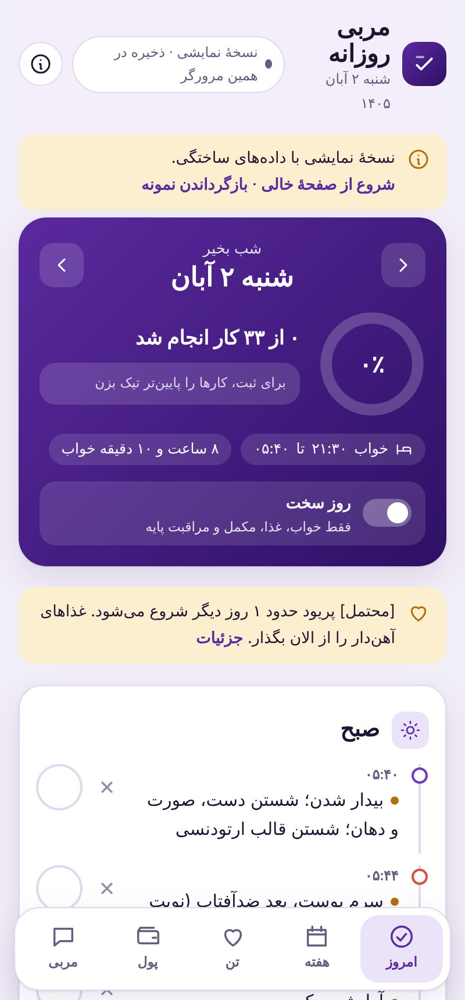
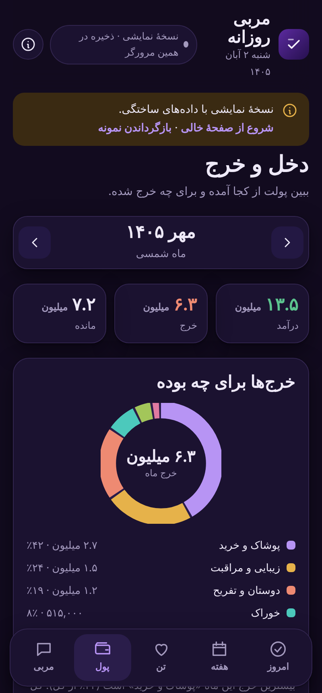
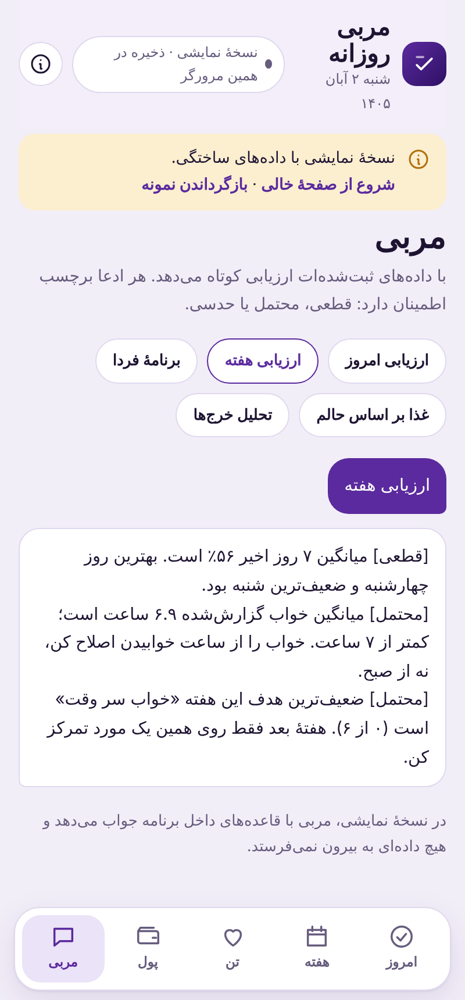

# مربی روزانه · Daily Mentor
**Live demo:**
https://mahsa2nyayi.github.io/mentor-daily/#today

A Persian (RTL) personal planner and mentor web app: adaptive daily schedule, done/skip tracking, out-of-routine events, body & cycle log with food suggestions, a food diary, and finance tracking from pasted bank SMS. Vanilla HTML/CSS/JS, no framework, no build step, no backend.

> **Demo:** open `index.html`, or enable GitHub Pages (Settings → Pages → Deploy from branch → `main` / root).
> All demo data is **fictional**. Everything is stored in your browser's `localStorage` only.

<p align="center">
  
  
  
</p>

## Features

- **Adaptive daily plan** – four day templates (work day, university day, Thursday, Friday) with computed wake/bed times and sleep duration.
- **Out-of-routine events** – add an appointment and that day's plan re-flows: optional items hidden, core items flagged as conflicts, late-end sleep warning.
- **"Hard day" mode** – one toggle keeps only essentials (sleep, food, supplements, basic care).
- **Growth analytics** – completion ring, weekly goals, streaks, colour calendar.
- **Body log** – flow, pain, mood, symptom chips; cycle length estimate and next-date prediction; rule-based food suggestions, each claim tagged `[قطعی]` / `[محتمل]` / `[حدسی]` (certain / probable / guess).
- **Food diary** – log what you actually ate with a reaction score; detects foods that repeatedly cause bad reactions.
- **Finance** – paste bank SMS text; amounts and categories are parsed with regexes. Only amount/type/category are stored (never the raw SMS, balances or card numbers). SVG donut chart, Persian-month totals.
- **Offline rule-based mentor** – reviews today, the week, tomorrow, food and spending.
- Persian (Jalali) calendar via `Intl`, Persian digits, light/dark themes, mobile-first, accessible controls.

## Tech

| Area | Choice |
|---|---|
| UI | Vanilla JS (ES5-style IIFE), CSS custom properties, RTL |
| Dates | `Intl.DateTimeFormat('fa-IR-u-ca-persian')` |
| Charts | Inline SVG / CSS, no libraries |
| Storage | `localStorage` (`mentor.v2`) |
| Parsing | Regex-based SMS parser (digit normalisation, rial→toman) |
| Fonts | Vazirmatn, Markazi Text (Google Fonts) |

## Structure

```
index.html   app shell
styles.css   theme tokens + components
app.js       schedule engine, stats, body/food/finance logic, demo seed & coach
docs/screenshots/
```

Data model (all keyed in one JSON blob): day docs `YYYY-MM-DD` (`done`, `skip`, `energy`, `sleep`, flow/pain/mood, `sym`, `food[]`), events `ev_*`, transactions `tx_*`.

## Limitations

- Browsers cannot read phone SMS; the app parses text you paste.
- Food/health suggestions are general rules, **not medical advice**.
- The demo mentor is rule-based; the original private version used an LLM.

## Run locally

```bash
git clone https://github.com/mahsa2nyayi/mentor-daily.git && cd mentor-daily
open index.html        # or: python3 -m http.server
```

Use the bar at the top of the app to start from an empty page or restore the sample data.

## License

MIT
